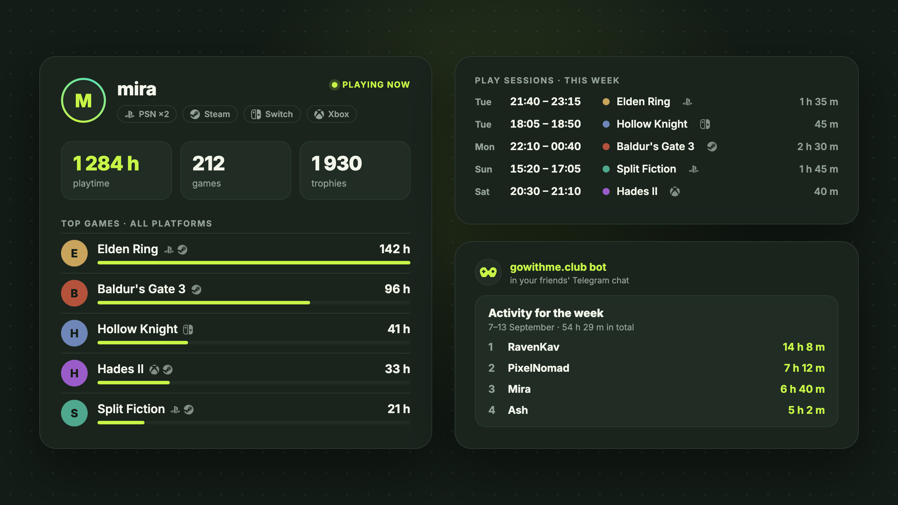

  

**[gowithme.club](https://gowithme.club) is a free cross-platform game tracker.**
One profile collects your games, playtime, play sessions, trophies and
achievements from every platform and account you play on.

## What you get

- **One profile for every platform.** PlayStation, Steam, Xbox, Nintendo Switch,
  Discord and jailbroken consoles side by side.
- **Several accounts merged.** A second Steam account or PSN accounts from
  different regions count as one player; the same game from different accounts
  is one game with its hours added up.
- **Real play sessions.** Not just lifetime totals: “played on Tuesday from
  21:40 to 23:15”, recorded while you play.
- **Trophies and achievements** from PSN, Steam and Xbox on one timeline.
- **Playing now.** Friends see what you are playing at the moment.
- **Public pages.** Every player and every game has a page: total hours, who
  plays it, recent sessions and trophies.
- **Communities.** Groups of friends get rankings, shared activity and a Telegram
  bot that posts reports to their chat.
- **Reports.** Weekly and monthly summaries in Telegram or by email.
- **Release calendar** built from the players' wishlists.

## Platforms

**Accounts:** PlayStation Network (PS4, PS5) · Steam · Xbox · Nintendo Switch 1 & 2 · Discord

**Jailbroken consoles:** PS5 (payload) · PS3 (HEN, CFW) · Switch (Atmosphere)

  

## Get started

1. Sign in at [gowithme.club](https://gowithme.club) with Google or Telegram.
2. Connect your accounts in the settings; each one has a step-by-step guide.
3. Your profile fills in by itself.

## Open-source console trackers

For a jailbroken PS5, a PS3 on HEN or CFW and a Switch with Atmosphere the
tracker runs on the console itself. The code is open under MIT:
[ps5-playtime-tracker](https://github.com/gowithme-club/ps5-playtime-tracker) ·
[ps3-playtime-tracker](https://github.com/gowithme-club/ps3-playtime-tracker) ·
[switch-playtime-tracker](https://github.com/gowithme-club/switch-playtime-tracker).

